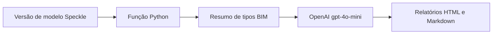

 |  | 

# Canário Amarelo — Função Speckle Automate

## Visão geral

O README apresenta a Operação Canário Amarelo como uma iniciativa de soberania digital ligada à Impulso Digital, IA, blockchain e Tokens Aurora. O código público verificável, porém, implementa uma função Speckle Automate: recebe a versão de um modelo, conta tipos de objetos numa amostra de até 150 e envia esse resumo textual à API OpenAI (modelo gpt-4o-mini) para gerar relatórios HTML e Markdown. Não há implementação visível de tokenização ou de integração com blockchain; portanto, descreva isso como objetivo declarado, não como recurso implementado.

## Objetivo e valor

**Problema/escopo:** Função Speckle Automate em Python que resume tipos de objetos BIM e gera relatórios de análise via OpenAI.

**Valor verificável hoje:** o repositório torna explícitos seus artefatos, interfaces e limitações para que mantenedores e contribuidores possam avaliar o que existe sem confundir demonstração, proposta e produção.

## Arquitetura e tecnologias

Fluxo de código verificável: ponto de entrada `execute_automate_function` → `AutomationContext.receive_version()` → `flatten_base` → contagem de tipos de objetos e composição de resumo → chamada OpenAI Chat Completions com gpt-4o-mini → geração e armazenamento de relatório HTML e Markdown. O README menciona um fluxo e imagem de arquitetura, mas não documenta infraestrutura/deploy; a árvore não contém workflows públicos do GitHub Actions. A arquitetura sistêmica mais ampla é não documentada pelo código disponível.

- Python (linguagem reportada pelo GitHub; main.py).
- Python >=3.11, conforme pyproject.toml.
- Dependências declaradas: specklepy >=3.2.4, speckle-automate >=0.1.0, openai >=2.31.0 e pydantic >=2.13.0.
- Dependências opcionais de desenvolvimento declaradas: mypy, pytest e ruff; sua presença não comprova execução de testes.
- O código também importa flatten.flatten_base, mas não há módulo correspondente na árvore nem dependência `flatten` declarada no manifesto.

## Início rápido

Os comandos abaixo refletem instruções, manifestos ou pontos de entrada presentes no repositório. Dependências externas, segredos e serviços estão indicados quando aplicável; a presença de um comando não equivale a uma execução validada.

1. Instalação: não há comando de instalação documentado no README nem arquivo de lock/requisitos na árvore. pyproject.toml declara dependências e requer Python >=3.11, mas não prescreve um procedimento de instalação.
2. Execução: main.py contém um bloco `if __name__ == "__main__"` que chama `execute_automate_function(automate_function, FunctionInputs)`, permitindo identificar o ponto de entrada. O README não informa comando de execução; não foi validada execução local e a importação `flatten` não está declarada/visível no repositório.

## Exemplo de uso

Exemplo compatível com as interfaces do código: em execução via Speckle Automate, fornecer o campo obrigatório `openai_api_key` e, opcionalmente, `analysis_prompt` (há um prompt padrão); a função recebe a versão pelo AutomationContext e armazena os arquivos `relatorio_canario.html` e `relatorio_canario.md` como resultados. Isso descreve o fluxo implementado, não comprova uma implantação funcional ou serviço Aurora próprio.

## Estado e limitações

**Maturidade indicada:** Experimental.

- Não apresentar soberania de dados, processamento em infraestrutura brasileira, IA Aurora própria, blockchain ou emissão de Tokens Aurora como capacidades comprovadas pelo código. A chamada é para OpenAI; embora os objetos não sejam incluídos diretamente na mensagem, o resumo de tipos/contagens é enviado ao serviço externo.
- O código limita a contagem a `flat_objects[:150]`, mas inclui o total de objetos no resumo; documentar essa distinção para não sugerir análise integral dos elementos.
- Não afirmar que testes passam, que a função foi implantada ou que os comandos funcionam: nenhum resultado de execução/teste foi verificado.
- A inconsistência de dependência `flatten` pode impedir inicialização num ambiente instalado apenas com as dependências listadas.

## Contribuição

Leia [CONTRIBUTING.md](CONTRIBUTING.md) antes de abrir uma issue ou pull request. Para reportes de segurança, siga a orientação específica do repositório, se houver.

## Licença

Este repositório está licenciado sob **Apache-2.0**; consulte [LICENSE](LICENSE).

## Patrocínio e apoio

O desenvolvimento aberto exige tempo para manutenção, documentação, testes, revisão de contribuições e resposta a issues. Se este projeto for útil, considere apoiar a continuidade pelo [GitHub Sponsors](https://github.com/sponsors/felipetjmg1-bit). O apoio não representa promessa de funcionalidades, prazo de entrega ou suporte comercial.

